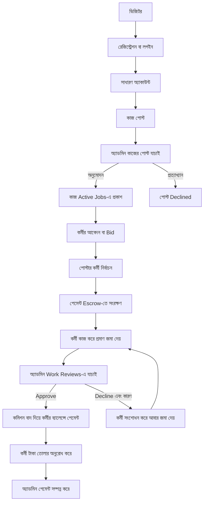

# JMJob ওয়েবসাইটের পূর্ণ জীবনচক্র ও প্রধান কর্মপ্রবাহ

**সর্বশেষ যাচাই:** ১৬ অক্টোবর ২০২৬

**উদ্দেশ্য:** JMJob-এ অ্যাকাউন্ট তৈরি থেকে কাজ পোস্ট, কাজ সম্পন্ন, অ্যাডমিন রিভিউ, পেমেন্ট ও টাকা তোলা পর্যন্ত প্রধান ধাপগুলো সহজভাবে বোঝানো।

## এক নজরে মূল কর্মপ্রবাহ



এখানে **দুটি আলাদা অ্যাডমিন অনুমোদন** আছে: প্রথমটি কাজের পোস্ট প্রকাশের জন্য, দ্বিতীয়টি কর্মীর জমা দেওয়া কাজ যাচাই করে পেমেন্ট ছাড়ার জন্য।

## ১. ব্যবহারকারীর ধরন

- **ভিজিটর:** লগইন ছাড়াই সাইট দেখতে পারে; কাজ করা বা পোস্ট করার জন্য অ্যাকাউন্ট প্রয়োজন।
- **সাধারণ অ্যাকাউন্ট:** একই অ্যাকাউন্ট দিয়ে অন্যের কাজে কর্মী হিসেবে আবেদন করা এবং নিজের কাজ পোস্ট করা যায়।
- **অ্যাডমিন:** কাজের পোস্ট ও জমা দেওয়া প্রমাণ যাচাই, পেমেন্ট/উইথড্র রিভিউ, ব্যবহারকারী ব্যবস্থাপনা এবং সিস্টেম সেটিংস নিয়ন্ত্রণ করেন।

## ২. অ্যাকাউন্ট তৈরি ও লগইন

১. ব্যবহারকারী নাম, ইমেইল, পাসওয়ার্ড এবং চাইলে ফোন নম্বর দিয়ে রেজিস্ট্রেশন করেন।
২. রেজিস্ট্রেশন OTP চালু থাকলে ফোনে SMS অথবা ইমেইলে ৬ সংখ্যার কোড যায়। কোড যাচাই হলে অ্যাকাউন্ট তৈরি হয়। OTP বন্ধ থাকলে সরাসরি রেজিস্ট্রেশন সম্পন্ন হয়।
৩. ব্যবহারকারী ইমেইল ও পাসওয়ার্ড দিয়ে লগইন করেন। পাসওয়ার্ড ভুলে গেলে ইমেইলে পাঠানো কোড দিয়ে নতুন পাসওয়ার্ড সেট করা যায়।
৪. রেফারেল লিংক দিয়ে এলে রেফারেল কোডটি অ্যাকাউন্টের সঙ্গে যুক্ত হয়।

## ৩. পোস্টার কীভাবে কাজ পোস্ট করেন

পোস্টার **Post a Job** ফর্মে সাধারণত নিচের তথ্য দেন:

- কাজের ক্যাটাগরি ও সাবক্যাটাগরি
- কাজের শিরোনাম, বর্ণনা ও নির্দেশনা
- কতজন কর্মী প্রয়োজন
- প্রতি কর্মীর পারিশ্রমিক
- কাজ জমা দেওয়ার শেষ সময়
- কী ধরনের প্রমাণ লাগবে—লিখিত বিবরণ, স্ক্রিনশট/ছবি, ফাইল বা লিংক

পোস্টার পরে **Previously Posted Jobs / My Jobs** থেকে পোস্টের অবস্থা, কর্মীর অগ্রগতি এবং খরচ দেখতে পারেন।

### খরচের হিসাব

পোস্টিং ফর্মে দেখানো হিসাব:

```text
মূল কাজের বাজেট = কর্মী সংখ্যা × প্রতি কর্মীর পারিশ্রমিক
দেখানো মোট খরচ = মূল কাজের বাজেট + System Fee
```

বর্তমান ফর্মে System Fee-এর প্রাথমিক হার ৩০%। উদাহরণ:

| হিসাব | মূল বাজেট | ৩০% System Fee | দেখানো মোট |
|---|---:|---:|---:|
| ১০ জন × ৳৫ | ৳৫০ | ৳১৫ | ৳৬৫ |
| ১০ জন × ৳৬ | ৳৬০ | ৳১৮ | ৳৭৮ |

অ্যাডমিন কোনো কর্মীকে অ্যাসাইন করার আগে প্রতি কাজের রেট ৳৫ থেকে ৳৬ করতে পারেন। রেট পরিবর্তন হলে কাজের বাজেট ও দেখানো মোট খরচ নতুন করে হিসাব হয়। অন্তত একজন কর্মী অ্যাসাইন হওয়ার পর কর্মী সংখ্যা বা প্রতি কর্মীর রেট বদলানো যায় না।

> **টাকার হিসাব বোঝার জন্য:** পোস্টিংয়ের সময়ের `System Fee` এবং কাজ অনুমোদনের সময় কাটা `commission_rate` আলাদা হিসাব। বর্তমান ডিফল্ট পেআউট কমিশন ১০%। পোস্ট জমা দিলেই দেখানো মোট টাকা পোস্টারের ওয়ালেট থেকে স্বয়ংক্রিয়ভাবে কেটে নেওয়া হয় না; পোস্টটি প্রথমে অ্যাডমিন অনুমোদনের অপেক্ষায় থাকে এবং ফর্মে পেমেন্ট/অনুমোদন নিয়ে WhatsApp-এ যোগাযোগের ধাপ দেখানো হয়। কর্মী নির্বাচিত হলে তার অনুমোদিত কাজের টাকা ওয়ালেট থেকে Escrow-তে রাখা হয়।

## ৪. অ্যাডমিনের কাজের পোস্ট যাচাই

অ্যাডমিন প্যানেলের **Job Management Center → Job Post (Pending Approval)** তালিকায় নতুন পোস্ট আসে। অ্যাডমিন এখানে কাজের বিবরণ, প্রমাণের চাহিদা, কর্মী সংখ্যা, প্রতি-কর্মীর রেট এবং মোট হিসাব যাচাই করেন।

- **Approve / Activate:** কাজটি `Open` হয় এবং কর্মীরা Active Jobs-এ দেখতে ও আবেদন করতে পারে।
- **Decline:** পোস্টটি প্রকাশ করা হয় না; প্রত্যাখ্যানের কারণ সংরক্ষণ করা হয়।
- **Edit:** কোনো কর্মী অ্যাসাইন হওয়ার আগে অ্যাডমিন পোস্টের তথ্য বা রেট সংশোধন করতে পারেন।

এই ধাপটি কর্মীর জমা দেওয়া কাজের রিভিউ থেকে আলাদা।

## ৫. কর্মী আবেদন ও অ্যাসাইনমেন্ট

১. কর্মী **Available Jobs / Active Jobs** থেকে অনুমোদিত কাজ দেখেন।
২. কাজের বিবরণ, পারিশ্রমিক, সময়সীমা এবং কী প্রমাণ দিতে হবে তা পড়ে Bid/আবেদন জমা দেন। নিজের পোস্ট করা কাজে নিজের অ্যাকাউন্ট দিয়ে আবেদন করা যায় না।
৩. পোস্টার **My Jobs**-এর কাজের বিস্তারিত পৃষ্ঠা থেকে Bid-গুলো দেখে কর্মী নির্বাচন করেন।
৪. কর্মী নির্বাচিত হলে escrow সেটিংস অনুযায়ী প্রয়োজনীয় কাজের টাকা পোস্টারের `Available Wallet` থেকে `Frozen / Escrow Balance`-এ স্থানান্তরিত হয়। পর্যাপ্ত ওয়ালেট ব্যালেন্স না থাকলে অ্যাসাইনমেন্ট সম্পন্ন করা যায় না।
৫. নির্বাচিত কর্মী **Active Jobs** বা কাজের বিস্তারিত পৃষ্ঠা থেকে নির্দেশনা অনুসরণ করে কাজ শুরু করেন। একটি পোস্টে একাধিক কর্মী থাকলে প্রত্যেকের জন্য আলাদা অ্যাসাইনমেন্ট ও আলাদা পেমেন্ট রেকর্ড থাকে।

## ৬. কাজ সম্পন্ন করে প্রমাণ জমা

কাজ শেষ হলে কর্মী কাজের বিস্তারিত পৃষ্ঠার **Submit Work** ফর্ম ব্যবহার করেন। কাজের চাহিদা অনুযায়ী জমা দেওয়া যায়:

- লিখিত বিবরণ বা রিপোর্ট
- স্ক্রিনশট/ছবি
- PDF, DOC বা DOCX ফাইল
- বাহ্যিক লিংক

কোনো কাজের শর্তে ছবি বা রিপোর্ট বাধ্যতামূলক থাকলে সেই ঘর পূরণ না করে জমা দেওয়া যাবে না। সাধারণত JPG, PNG, GIF ও WEBP ছবি সর্বোচ্চ ১০ MB এবং PDF/DOC/DOCX সর্বোচ্চ ২০ MB হতে পারে।

জমা দেওয়ার পর কাজ `Pending Review` হয় এবং পেমেন্ট Escrow-তেই থাকে। প্রমাণের ফাইল শুধু সংশ্লিষ্ট কর্মী, কাজের পোস্টার এবং অ্যাডমিন দেখতে পারেন।

## ৭. অ্যাডমিনের কাজের প্রমাণ রিভিউ

অ্যাডমিন প্যানেলের **Job Management Center → Work Reviews**-এ অপেক্ষমাণ জমাগুলো দেখা যায়। অ্যাডমিন কাজের নির্দেশনা ও জমা দেওয়া লিখিত বিবরণ, লিংক এবং স্ক্রিনশট/ফাইল মিলিয়ে দেখেন।

- **Approve & Pay:** কাজ সঠিক হলে অ্যাডমিন অনুমোদন করেন। অ্যাসাইনমেন্ট-ভিত্তিক বর্তমান প্রবাহে একই ধাপে Escrow থেকে পেমেন্ট ছাড় হয়।
- **Decline:** কাজ অসম্পূর্ণ বা নির্দেশনার সঙ্গে না মিললে কারণ লিখে ফেরত দেন। জমাটি প্রত্যাখ্যাত হিসেবে সংরক্ষিত হয়, অ্যাসাইনমেন্ট `Revision` অবস্থায় যায় এবং কর্মী সংশোধন করে নতুন করে জমা দিতে পারেন। কারণ ছাড়া Decline করা যায় না। এই সময়ে পেমেন্ট ছাড়া হয় না।
- **Poster review:** পোস্টার জমা দেওয়া কাজ দেখতে এবং সংশোধন চাইতে পারেন। নতুন অ্যাসাইনমেন্টের পেমেন্ট ছাড়ার অনুমোদন অ্যাডমিনের Work Reviews থেকেই হয়।

অ্যাডমিন কোনো সন্দেহজনক প্রমাণ দেখলে ঝুঁকির সংকেত যাচাই করতে পারেন। স্বয়ংক্রিয় ঝুঁকি সংকেত নিজে থেকে পেমেন্ট ছাড়ে না বা ব্যবহারকারীকে নিষিদ্ধ করে না; সিদ্ধান্ত অ্যাডমিন নেন।

## ৮. অনুমোদনের পর পেমেন্ট ও কমিশন

অ্যাডমিন অনুমোদন দিলে সিস্টেম অ্যাসাইনমেন্টের অনুমোদিত পরিমাণ থেকে `commission_rate` হিসাব করে:

```text
কমিশন = অ্যাসাইনমেন্টের পেমেন্ট × কমিশনের হার
কর্মীর প্রাপ্য = অ্যাসাইনমেন্টের পেমেন্ট − কমিশন
```

উদাহরণ: যদি একটি অ্যাসাইনমেন্টের অনুমোদিত পেমেন্ট ৳৬ হয় এবং কমিশনের হার ১০% থাকে, কমিশন হবে ৳০.৬০ এবং কর্মী পাবেন ৳৫.৪০। কমিশনের হার অ্যাডমিন সেটিংস থেকে পরিবর্তনযোগ্য।

পেমেন্ট ছাড় হলে:

- কর্মীর আয় `Balance`-এ যোগ হয়;
- পোস্টারের Escrow থেকে সংশ্লিষ্ট টাকা ছাড় হয় এবং `Total Spent` হালনাগাদ হয়;
- কমিশন ও পেমেন্ট Transaction History-তে রেকর্ড হয়;
- অ্যাসাইনমেন্ট `Completed` হয়। একই অ্যাসাইনমেন্টে পুনরায় অনুমোদন দিলেও দ্বিতীয়বার টাকা দেওয়া হয় না।

## ৯. বাতিল, ফেরত ও বিরোধ

- অ্যাসাইনমেন্ট বাতিল হলে অ্যাডমিন প্রয়োজন অনুযায়ী কর্মী বাতিল বা পুনরায় অ্যাসাইন করতে পারেন; বাতিলের ক্ষেত্রে Escrow-র টাকা ফেরত হয়।
- কাজের পোস্টার পোস্ট বাতিল করলে অব্যবহৃত/ধরে রাখা Escrow ফেরত দেওয়ার প্রক্রিয়া চালু হয়।
- বিরোধ থাকলে অ্যাডমিন কাজটি `Disputed` হিসেবে চিহ্নিত করে তথ্য যাচাই ও সমাধান করতে পারেন।
- কাজের সময়সীমা কাছে এলে পোস্টার, সংশ্লিষ্ট কর্মী এবং অ্যাডমিনকে নোটিফিকেশন পাঠানো হতে পারে।

## ১০. অন্য আয়ের পথ ও টাকা তোলা

মার্কেটপ্লেসের কাজ ছাড়াও সেটিংস চালু থাকলে ব্যবহারকারী বিজ্ঞাপন/ভিডিও দেখা, ওয়েব টাস্ক, Telegram টাস্ক, দৈনিক বোনাস ও রেফারেলের মাধ্যমে আয় করতে পারেন। যাচাই করা রিওয়ার্ড ব্যবহারকারীর সাধারণ `Balance`-এ যোগ হয়; এটি পোস্টারের কাজের Escrow থেকে আলাদা।

যোগ্য ব্যালেন্স ও প্রযোজ্য নিয়ম পূরণ হলে ব্যবহারকারী Withdraw পৃষ্ঠা থেকে bKash বা Nagad নম্বর দিয়ে টাকা তোলার অনুরোধ করেন। অ্যাডমিন অনুরোধটি পর্যালোচনা করে অনুমোদন, প্রত্যাখ্যান অথবা পেমেন্ট সম্পন্ন করেন। ব্যবহারকারী নিজের Withdrawal History-তে অবস্থা দেখতে পারেন।

## ১১. অ্যাডমিন প্যানেলের প্রধান দায়িত্ব

1. নতুন কাজের পোস্ট পরীক্ষা করে প্রকাশ বা প্রত্যাখ্যান করা।
2. প্রয়োজন হলে কর্মী অ্যাসাইন হওয়ার আগে পোস্টের রেট বা বিবরণ ঠিক করা।
3. **Work Reviews**-এ স্ক্রিনশটসহ কাজ যাচাই করে Approve & Pay বা কারণসহ Decline করা।
4. অ্যাসাইনমেন্ট, Escrow, বাতিল/ফেরত এবং বিরোধ পর্যবেক্ষণ করা।
5. চালু থাকলে ডিপোজিট ও Withdraw অনুরোধ যাচাই করা।
6. ব্যবহারকারী, ক্যাটাগরি, নোটিফিকেশন, বিজ্ঞাপন এবং প্ল্যাটফর্ম সেটিংস পরিচালনা করা।

## ১২. বর্তমান সিস্টেম সম্পর্কে গুরুত্বপূর্ণ নোট

- **Deposit UI:** ডিপোজিটের API ও পৃষ্ঠা আছে, কিন্তু সক্রিয় UI-তে ডিপোজিট নিয়ন্ত্রণ বর্তমানে feature flag দিয়ে লুকানো। তাই সাধারণ ব্যবহারকারী এই মুহূর্তে নেভিগেশন থেকে ডিপোজিট জমা দিতে নাও পারেন।
- **দুটি আলাদা ফি:** পোস্টিংয়ের System Fee মোট খরচের হিসাবে যোগ হয়; পেআউট কমিশন অনুমোদিত কর্মী-পেমেন্ট থেকে কাটা হয়। এই হার বা হিসাবকে একই ধরে নেওয়া যাবে না।
- **পুরোনো রেকর্ড:** অ্যাসাইনমেন্ট-ভিত্তিক নতুন কাজেই Admin Approve & Pay একই সঙ্গে পেমেন্ট ছাড়ে। পুরোনো/legacy রেকর্ডে রিভিউ ও পেমেন্টের ধাপ আলাদা হতে পারে।

## ১৩. অবস্থার সহজ শব্দকোষ

| নাম | অর্থ |
|---|---|
| `Pending Approval` | পোস্ট অ্যাডমিনের যাচাইয়ের অপেক্ষায় |
| `Open` | অনুমোদিত পোস্ট; কর্মীরা আবেদন করতে পারে |
| `Assigned / In Progress` | কর্মী নির্বাচিত; কাজ চলছে এবং টাকা Escrow-তে আছে |
| `Pending Review` | কর্মী কাজ ও প্রমাণ জমা দিয়েছে; অ্যাডমিন রিভিউ করবেন |
| `Revision` | কারণসহ সংশোধন চাওয়া হয়েছে; কর্মী আবার জমা দিতে পারবেন |
| `Completed / Released` | কাজ অনুমোদিত এবং পেমেন্ট ছাড় হয়েছে |
| `Declined / Rejected` | পোস্ট বা জমা প্রত্যাখ্যাত হয়েছে; কারণ/অবস্থা অনুযায়ী পরবর্তী পদক্ষেপ নিতে হবে |
| `Held / Escrow` | পোস্টারের টাকা সাময়িকভাবে সংরক্ষিত; কাজের সিদ্ধান্ত না হওয়া পর্যন্ত খরচ করা যাবে না |
| `Refunded` | বাতিল বা সমাধানের পর Escrow-র টাকা ফেরত দেওয়া হয়েছে |
